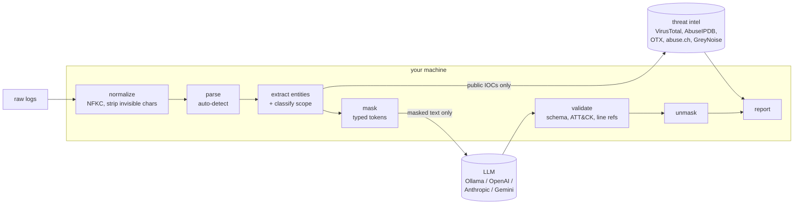

# Sudare

**AI-assisted incident analysis that never shows the AI who you are.**

Paste or upload raw security logs and get a structured incident analysis: verdict,
severity, timeline, ATT&CK techniques, investigation queries and next steps. Before
anything leaves your machine, Sudare replaces internal IPs, hostnames, usernames,
emails, secrets and internal URLs with typed placeholders such as `[[HOST_412]]`. The
model reasons on the placeholders, and Sudare puts the real values back in the report
on your side.

> *Sudare* (簾) are Japanese bamboo blinds. At the Heian court, a lady spoke with
> visitors from behind one: she could see them, they could not see her, and only she
> ever raised the blind.

**Status:** phase 2 of 4. The core library, the CLI and the Python package work today.
The web UI and server (phases 3–4) are not built yet. See [CHANGELOG.md](CHANGELOG.md).

## Quickstart

```sh
# Build (Rust 1.88+)
cargo install --path crates/sudare-cli

# A local model; nothing leaves the machine at all
ollama pull qwen3:8b

# Dry run: exactly what would be sent, with values masked
sudare mask auth.log --diff

# Analyse
sudare analyze auth.log
sudare analyze auth.log --format json > report.json
sudare analyze alert.cef --mode strict --chat

# A cloud model: you review the masked input and confirm before the first call
export ANTHROPIC_API_KEY=...
sudare analyze auth.log --provider anthropic
```

Native `.evtx` files work directly: `sudare analyze Security.evtx`.

## What gets sent where



- **The LLM** receives the masked log lines, the masked detection-rule text if you
  pass one, and threat-intel verdicts. In strict mode those verdicts are keyed by token.
- **Threat-intel providers** receive only public IPs, public domains, public URLs and
  file hashes, and only from providers you've given a key to. Private addresses,
  internal hostnames, usernames and emails are never eligible: the code that calls
  providers only accepts a `PublicIndicator`, and that type can only be built from a
  public value that contains nothing masked.
- **Nothing else.** There is no telemetry and no update check.

The mask map (token → real value) stays in memory, is zeroed when dropped, and is
never written to disk unencrypted.

## Masking

| Type | Default mode | Strict mode |
|---|---|---|
| Internal IPs, hostnames, internal domains and URLs | masked | masked |
| Usernames, emails, MACs, Windows SIDs | masked | masked |
| Secrets (passwords, keys, tokens, JWTs) | masked | masked |
| Public IPs, domains and URLs | kept | masked |
| Hashes, file paths, process names, CVEs | kept | masked |

Tokens are consistent within one analysis and its chat, so `[[USER_25]]` is the same
person everywhere. Token numbers come from a salted HMAC, and the salt is fresh for
every analysis, so a number reveals neither the order nor the count of values. Text in
the input that already looks like a token is masked as `[[LITERAL_n]]`, so it can't pose
as one.

"Internal" means RFC 1918, CGNAT, loopback, link-local and ULA addresses; `.local`,
`.internal`, `.lan`, `.corp` and `.home.arpa` names; single-label hostnames; and
anything you list in a policy. Sudare also learns your domain from fields where a log
source names itself (syslog host, Windows `Computer`). **Domains it can't recognise
as yours are treated as public.** The CLI lists them before sending, and you add your
own in the policy:

```toml
# sudare.toml (see policy.example.toml for every option)
mode = "default"

[classify]
internal_networks = ["198.18.0.0/15"]
internal_domains  = ["corp.example.com"]

[actions]
file_path = "mask"

[[rules]]
name = "employee_id"
pattern = 'EMP-\d{6}'
```

`sudare mask FILE --show-map` prints the token table to your terminal. Nothing in it
is sent anywhere.

## Formats

| Parser | Input |
|---|---|
| `syslog3164`, `syslog5424` | BSD and RFC 5424 syslog, with `key=value` messages |
| `cef`, `leef` | ArcSight CEF; QRadar LEEF 1.0 and 2.0; with or without a syslog header |
| `winxml` | Windows Event Log XML, and native `.evtx` |
| `json`, `ndjson` | JSON arrays, wrapper objects (`data`, `Records`, `hits.hits`), NDJSON |
| `winlogbeat`, `powershell-winevent`, `fortisiem` | TOML mappings over JSON |
| `raw` | anything else: one event per line |

New JSON-shaped formats need no Rust: they're [TOML mappings](CONTRIBUTING.md#add-a-parser).
The FortiSIEM mapping covers the documented fields of its public REST API. Seceon is a
[stub](docs/parsers/seceon.md) because its export layout isn't publicly documented.

## Providers

| LLM | Flag | Key |
|---|---|---|
| Ollama (default, local) | `--provider ollama` | none |
| OpenAI | `--provider openai` | `OPENAI_API_KEY` |
| Anthropic | `--provider anthropic` | `ANTHROPIC_API_KEY` |
| Google Gemini | `--provider gemini` | `GEMINI_API_KEY` |
| Any OpenAI-compatible server | `--provider openai-compatible --base-url URL --model M` | `SUDARE_OPENAI_COMPAT_KEY` (optional) |

Only loopback hosts, and hosts you list in `--local-hosts`, count as local. Any other
host gets the masked-input preview and needs your confirmation, or `--yes`. Ollama runs
with an explicit `num_ctx` (`--num-ctx`, default 16384) because it silently truncates
longer prompts. Input over the budget is sampled: rare event types first, then the
newest, middle and oldest of each type. The report says when that happened.

Threat-intel lookups are read-only (nothing is submitted). They're cached on disk for
24 hours, holding public indicators only, at `~/.cache/sudare/ti-cache.sqlite`, file
mode 0600. Each provider runs only when its key is set:

| Provider | Key | Terms to know (checked 2026-10-30) |
|---|---|---|
| VirusTotal | `SUDARE_VIRUSTOTAL_KEY` | Public API: 4 requests/min, 500/day, and it [must not be used in commercial products or services or in business workflows](https://docs.virustotal.com/reference/public-vs-premium-api). Use a premium key for SOC work. Sudare looks up at most 4 indicators per analysis. |
| AbuseIPDB | `SUDARE_ABUSEIPDB_KEY` | Free tier: [1,000 checks/day](https://www.abuseipdb.com/pricing). [Terms](https://www.abuseipdb.com/legal). |
| AlienVault OTX | `SUDARE_OTX_KEY` | Free with an account. [OTX](https://otx.alienvault.com/). |
| abuse.ch URLhaus + ThreatFox | `SUDARE_ABUSECH_KEY` | Volumes are [sized for non-commercial use](https://abuse.ch/terms-of-use/). Heavy commercial use may need a subscription. |
| GreyNoise Community | `SUDARE_GREYNOISE_KEY` | Free tier: [50 lookups/week with a business email](https://docs.greynoise.io/docs/using-the-greynoise-community-api). [Terms](https://www.greynoise.io/terms). |

Read each provider's terms yourself; they change, and the summaries above are not
legal advice.

## Report

`--format json` gives this shape (`schema_version` 1):

```jsonc
{
  "analysis": {
    "summary": "...", "verdict": "likely_true_positive",
    "severity": { "level": "high", "rationale": "..." },
    "confidence": { "score": 0.8, "would_change_it": "..." },
    "timeline": [{ "timestamp": "...", "description": "...", "source_lines": [3] }],
    "entities": [{ "ref": "jdoe", "role": "compromised account", "note": "" }],
    "attack_techniques": [{ "id": "T1110.001", "name": "Brute Force: Password Guessing", "evidence": "...", "evidence_lines": [1, 2] }],
    "recommended_actions": { "containment": [], "investigation": [{ "language": "spl", "query": "...", "purpose": "..." }], "eradication": [] },
    "open_questions": []
  },
  "entities": [{ "value": "198.51.100.23", "kind": "ip", "scope": "public", "action": "keep", "token": null, "enrichment": [] }],
  "warnings": [{ "code": "input_sampled", "detail": "..." }],
  "meta": { "provider": "ollama", "model": "qwen3:8b", "parser": "syslog3164", "attack_version": "v20.0" }
}
```

The model's reply is checked before you see it:
- **Format:** it must match the schema. A malformed reply gets one retry; after that the report shows the raw reply with a warning.
- **Line references:** references to lines that don't exist are removed.
- **ATT&CK IDs:** each is checked against the bundled ATT&CK index. Unknown IDs are dropped, revoked IDs are replaced by their successor, and names are corrected.
- **Entities:** an entity the model names that isn't in the input is dropped with a warning.
- **Reputation:** verdicts come only from threat intel, never from the model.

The markdown output escapes HTML and defangs links.

## Python

```python
import sudare

r = sudare.mask(open("auth.log").read(), mode="strict")
reply = my_llm(r.masked)          # only masked text leaves
print(r.unmask(reply))            # real values back, locally
```

Build with `maturin develop` in `crates/sudare-py`. PyPI wheels are planned.

## Threat model

**Protects against:**
- An LLM or threat-intel provider (or their logs, staff or breach) learning your internal network map, identities or credentials.
- Log content that attacks the analyst: prompt injection in log fields, XSS in URLs, fake tokens, look-alike Unicode.

**Mitigations:**
- Masking before egress, enforced in the type system: providers accept only `MaskedPrompt` and `PublicIndicator`.
- Input normalization (NFKC, invisible characters removed) before extraction.
- Logs sent between per-analysis random delimiters, with every line numbered.
- A system prompt that treats log content as data, never as instructions.
- Literal-token masking.
- Schema validation of every reply; rendering that escapes HTML.
- Linear-time regexes only, so no pattern can be made to hang on crafted input.
- `sudare-core` has no network dependency, which CI checks.
- A release-blocking leak test that records every outgoing byte for every fixture, provider and mode.

**Does not protect against:**
- Sensitive data written in free text with no recognizable shape. A hostname mentioned in prose with no `host=` label, or a person's name, only gets masked if it also appears in a field Sudare understands, or if you add a denylist term or rule.
- Inference: the model still sees event types, timings and public IOCs.
- A compromised machine running Sudare.
- A provider you mark as local that isn't.

Run `sudare mask --diff` on a sample of your own logs before trusting a new source.

## Development

```sh
cargo test --workspace            # unit, snapshot, property and leak tests
cargo clippy --workspace --all-targets -- -D warnings
cargo deny check                  # licences (no copyleft) and advisories
cargo +nightly fuzz run parse     # fuzzing, see fuzz/
```

Every fixture is synthetic: documentation IP ranges (192.0.2.0/24, 198.51.100.0/24,
203.0.113.0/24, 2001:db8::/32), `example.com`/`example.org` and invented names.
`fixtures/manifest.json` lists what must never leak. See [CONTRIBUTING.md](CONTRIBUTING.md).

## License

Apache-2.0. See [LICENSE](LICENSE) and [NOTICE](NOTICE). ATT&CK® is a registered
trademark of The MITRE Corporation. The bundled technique index is © The MITRE
Corporation and used under its [terms of use](https://attack.mitre.org/resources/legal-and-branding/terms-of-use/).
